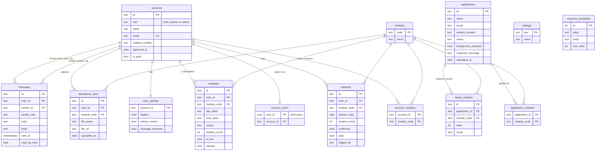

# TutorLink Mobile

[](https://github.com/Dylan-Gorrah/TutorLink-Mobile_part2/actions/workflows/android.yml)

A native Android app (Kotlin + Jetpack Compose) for the Rosebank College tutoring programme. Tutors, lecturers and programme admins each get their own app, running on real data in Supabase through our own REST API.

XISD6329 Task 2.

## Tech stack

- Kotlin, Jetpack Compose + Material 3, Navigation Compose (slide transitions), ViewModel + coroutines + StateFlow
- kotlinx.serialization, DataStore (a local copy of personal settings)
- supabase-kt (Auth, Storage) on Ktor (OkHttp engine); Google SSO through the deep link `tutorlink://auth-callback`
- Our API: one Supabase Edge Function in TypeScript (`supabase/functions/api`)
- Tests: JUnit 4, Ktor `MockEngine`, kotlinx-coroutines-test, run by GitHub Actions on every push

## Running it

1. Open the project in Android Studio (JDK 17, Android SDK 37 installed).
2. Add these two lines to `local.properties` (it is git-ignored). Use the project URL and the **anon** key from Supabase → Project Settings → API:
   ```
   SUPABASE_URL=https://tvjhdelprudquvtjnbns.supabase.co
   SUPABASE_ANON_KEY=<anon key>
   ```
3. Run the `app` configuration on a phone or emulator (Android 8.0+, portrait).

Without `local.properties` the app still builds (placeholder values), which is what CI does, but it can't sign in.

## Tests

```
./gradlew testDebugUnitTest
```

- `ValidatorsTest`: sign-in, lecturer registration and password rules, the wrong-role check, student count, rate, minimum mark and message rules
- `ApiClientTest`: the API client against a Ktor `MockEngine`. It checks that JSON is read properly, that the right token goes with each call, and that 400 / 401 / 403 / 500 errors, broken JSON and no internet all become messages instead of crashes.
- `TutorLogicTest`: pay maths (confirmed × rate, pending, projected), rand formatting, the CSV statement, the timeline dot rules, the unread count, "delivered" receipts, the "42m / 5h / Yst" times, and the tutor repository against a mock server
- `StaffRepositoryTest`: lecturer and admin endpoints: the 403 when a lecturer messages outside their modules, the approve body and the new tutor it returns, rate changes, application marks and the status filter

GitHub Actions (`.github/workflows/android.yml`) runs the tests and builds the debug APK on every push and pull request, then uploads the test report and the APK.

## Test logins

All test accounts use the password **`123456`**. Type the short name (the app adds `@tutorlink.demo`) or the full email.

| Role | Login | Who |
|---|---|---|
| Tutor | `student1` | Refiloe Matsau (PROG1111, NETW1111) |
| Tutor | `student2` | Sipho Ndlovu (NETW1111, PROG1111) |
| Tutor | `student3` – `student10` | Lindiwe, Kagiso, Ayesha, Tumelo, Nadia, Lwazi, Chloe, Bongani |
| Tutor (Google SSO) | `dylangorrah3@gmail.com` | Dylan Gorrah (ISEC6321, PROG6221, HCIN6222) |
| Lecturer | `lecturer1` | Dr M. Pretorius (PROG1111, NETW1111) |
| Lecturer | `lecturer2` | Ms T. Naidoo (DATA6211, DATA6222, SAND6221) |
| Lecturer | `lecturer3` | Mr J. Botha (PROG6221, PROG6212, ISEC6321, HCIN6222) |
| Admin | `admin1` | Programme Admin |

Lecturers can also register themselves in the app with a `@rosebank.ac.za` address. When admin approves an application, the new tutor signs in with their `@tutor.rosebank.ac.za` email and the same test password.

## API

One Supabase Edge Function, `api` (TypeScript, `supabase/functions/api/index.ts`).

Base URL: `https://tvjhdelprudquvtjnbns.supabase.co/functions/v1/api`

Every call sends the signed-in user's access token. The function looks up the caller's role and returns `403` for anything that role isn't allowed to do. Its queries run as the user, so row-level security still applies. Errors are JSON: `{ "error": "plain message" }` with `400` (bad input), `401` (not signed in), `403` (wrong role, or a lecturer outside their modules), `404`, `409` (already done) or `500`.

| Who | Method & path | Does |
|---|---|---|
| All | `GET /me` | Account, role, modules, personal settings, unread count |
| All | `GET` / `PUT /settings` | Personal settings (haptics, reduce motion, message previews) |
| Tutor | `PATCH /messages/{id}/read` | Mark a notice read |
| Public | `POST /lecturer/register` | Create a lecturer login + account + modules |
| Lecturer | `PUT /lecturer/modules` | Change the modules they teach |
| Lecturer | `GET /lecturer/tutors` | Counts and tutors on their modules, with last message and unread dot |
| Lecturer | `GET /lecturer/threads` | Notices they sent, newest first |
| Tutor | `GET /tutor/schedule` | Upcoming sessions, month totals, pending sessions, unread count |
| Tutor | `POST /tutor/sessions/{id}/mark` | Mark today's session → logged as pending |
| Tutor | `GET` / `POST /tutor/sessions` | Logged sessions / log a session (pending) |
| Tutor | `GET` / `POST /tutor/registers` | Uploaded attendance registers |
| Tutor | `GET /tutor/pay` | Approved, pending, projected, rate and lines |
| Tutor | `GET /tutor/messages` | Their thread |
| Lecturer, Admin | `GET /messages/thread/{tutorId}` | One tutor's thread |
| Lecturer, Admin | `POST /messages` | Send a notice (lecturers: only tutors on their modules) |
| Admin | `GET /admin/overview` | Open applications, active tutors, outstanding pay, sessions to confirm |
| Admin | `GET /admin/applications?status=` | Applications with an eligibility flag |
| Admin | `GET /admin/applications/{id}` | Detail with marks |
| Admin | `POST /admin/applications/{id}/background-check` | Record the check → under review |
| Admin | `POST /admin/applications/{id}/decision` | Approve (creates the tutor + welcome message) or decline |
| Admin | `GET /admin/tutors`, `GET /admin/tutors/{id}` | Tutors and what they're owed; detail |
| Admin | `POST /admin/sessions/{id}/confirm` | Confirm a session |
| Admin | `POST /admin/tutors/{id}/sessions` | Add a session (confirmed straight away) |
| Admin | `POST /admin/tutors/{id}/mark-paid` | Mark confirmed sessions paid |
| Admin | `GET /admin/threads` | Every notice, newest first |
| Admin | `GET` / `PUT /admin/programme-settings` | Rate per session, minimum mark |
| Admin | `GET /admin/templates` | Approve / decline response templates |

## Database

TutorLink v2 on Supabase. Migrations live in `supabase/migrations/`. Every table has row-level security: tutors see only their own data, lecturers see tutors who share one of their modules, admin sees everything, and signed-out users see nothing. Passwords are hashed by Supabase Auth and never stored in our tables.



| Table | Rows | Holds |
|---|---|---|
| `accounts` | 15 | Every tutor, lecturer and admin |
| `account_users` | 15 | Links each Supabase Auth login to an account |
| `user_settings` | 15 | Personal settings (one per account, made by a trigger) |
| `modules` | 11 | Module codes and names |
| `account_modules` | 32 | Modules each tutor tutors / lecturer teaches |
| `applications` | 11 | Tutor applications from the website |
| `application_modules` | 19 | Modules each applicant applied for |
| `report_modules` | 29 | Marks on each applicant's academic record |
| `sessions` | 25 | Logged sessions (pending → confirmed → paid) |
| `schedule` | 15 | Upcoming timetabled sessions |
| `attendance_docs` | 11 | Uploaded signed registers |
| `messages` | 20 | Notices, one thread per tutor |
| `settings` | 11 | Programme settings (rate per session, minimum mark, …) |
| `response_templates` | 10 | Approve / decline replies |

## Secrets

The Supabase URL and the public anon key go in `local.properties` (not in git) and reach the code through `BuildConfig`. The service-role key is only ever used inside the Edge Function, where Supabase provides it as an environment variable.
